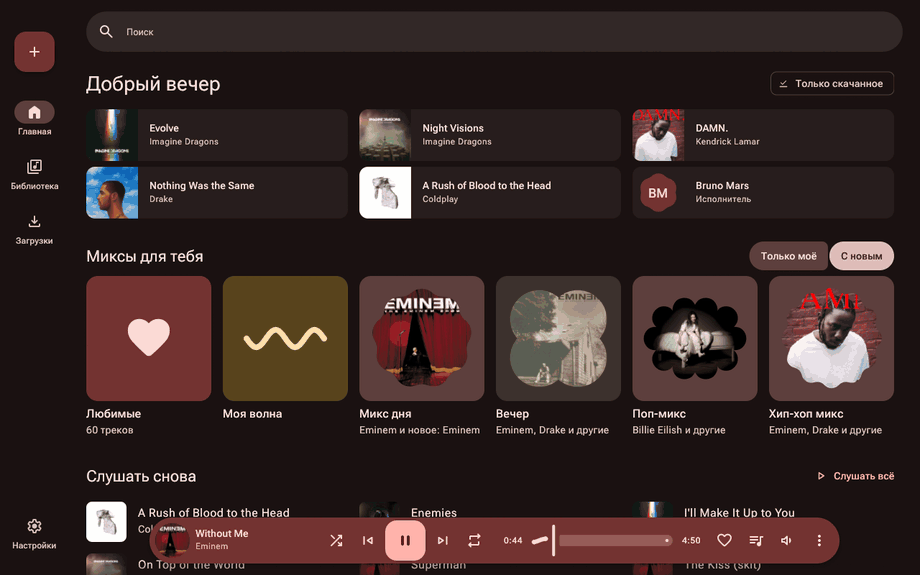
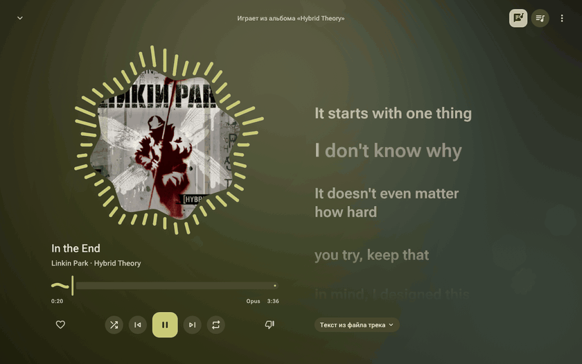
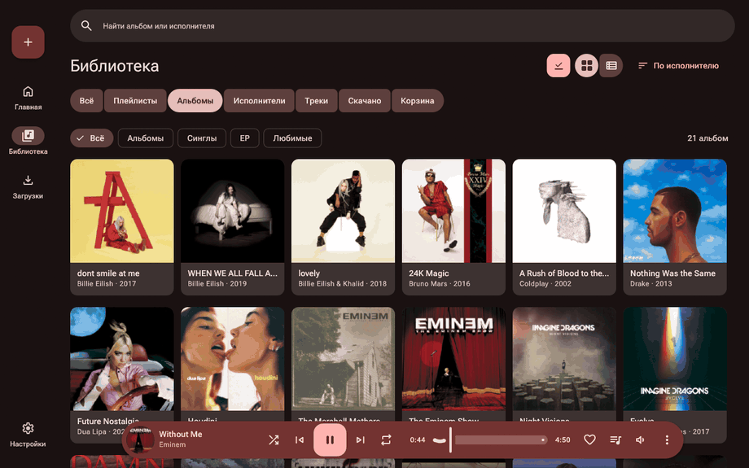
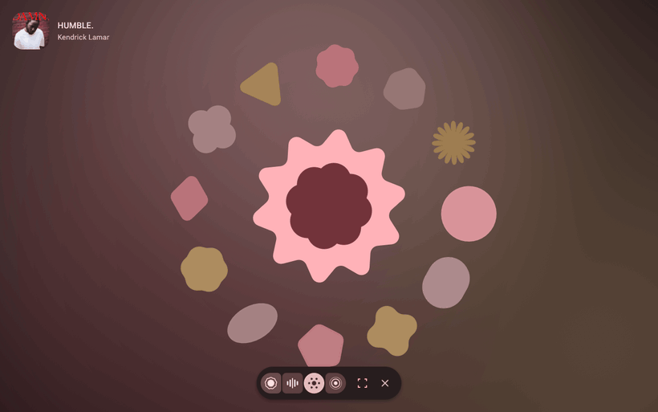
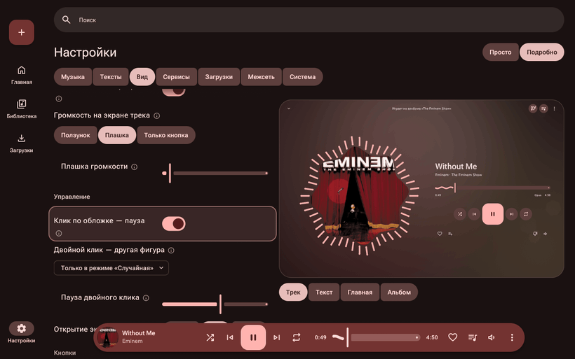
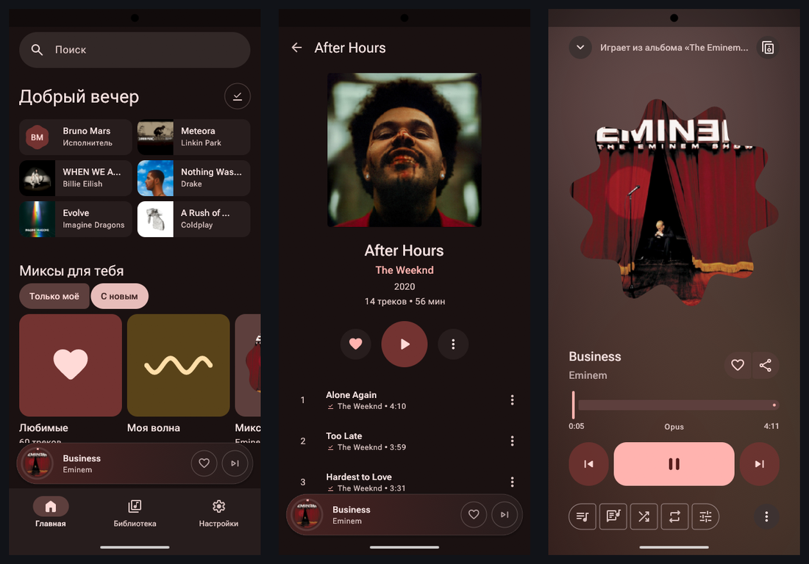

<div align="center">


# music.nikgob

**Native local-first music player in Rust — automatic library curation, streaming bridge, on-device karaoke alignment, taste learning, and multi-device mesh.**

Made by **[NikGob](https://github.com/NikGob)**

[](README.ru.md)
[](https://github.com/NikGob/music.nikgob/releases)
[](LICENSE.md)

<br />



</div>

---

> [!WARNING]
> **Early Pre-Release (`v0.1.0`) — Raw & Needs Real-World Testing**
>
> `music.nikgob` is a personal daily-driver player opening up for its first public pre-release. Expect rough edges:
> - **Spotify & SoundCloud** work, but have seen **very limited real-world testing** across different account tiers, regional restrictions, rate limits, and multi-device handoffs.
> - **Linux builds** (`x86_64` Wayland/X11, NixOS flake, and headless `nikgobd` on `aarch64`) compile and run, but have been **tested far less** than Windows (especially PipeWire/PulseAudio device switching, WebKitGTK sign-in windows, and keyring edge cases).
> - **Phone / Mobile UI (`crates/mobile`)** is in a **VERY early prototype stage** — currently a portrait touch layout running inside a desktop harness (`nikgob-phone`), not a packaged Android app yet.
> - **UI language**: full **Russian and English** localization across both desktop and mobile UIs, with live switching in Settings.

---

## Concept

Streaming services rent access to disappearing catalogs; traditional local players make you babysit folders, tags, and files by hand. **`music.nikgob` combines local ownership with streaming convenience in a single native binary:**

1. **Permanent Track Identity, Replaceable Sources.** Every song has a stable UUID (linked to MusicBrainz / ISRC / AcoustID). Playlists, likes, play history, and recommendation models point to the track ID — never to a file path or stream URL. A track can hold multiple sources (`Hi-Res FLAC > CD FLAC > Opus > AAC/MP3 > Spotify > YouTube Music > SoundCloud`) and always plays the best available one.
2. **Stream Now, Own on Like.** Search and listen instantly across your local library, **Spotify**, **YouTube Music**, and **SoundCloud** through one audio engine (gapless, R128 loudness, 10-band EQ, speed/pitch control). Hit **Like** on a streaming song and the player queues it in the Wishlist, searches configured download sources (Torznab/Prowlarr torrents via embedded `librqbit`, Soulseek, Bandcamp, Internet Archive, Subsonic, khinsider), verifies lossless authenticity via spectrum analysis (catching fake MP3-to-FLAC transcodes), encodes a working `.opus` (`~160 kbps VBR`), archives the bit-exact `.flac` master, writes clean tags + cover art, and **silently replaces the stream in all your playlists and mixes**. Lossy files are kept as-is (`lossy -> lossy` transcoding never happens).
3. **Zero-WebView Native UI.** Drawn directly on OpenGL via `egui` + `fastframe` following **Material 3 Expressive**: analytical spring physics, morphing Material polygon covers (`androidx.graphics.shapes` port), dynamic per-album color schemes (`material-colors`), audio-reactive ambient clouds, and a 4-mode visualizer. Closing the window to the tray drops redraws to **zero** and trims GPU textures while music keeps playing.
4. **On-Device Lyrics & Taste Engine.** Every fetched lyric (LRCLIB, Genius, embedded tags) is checked against the actual audio so mismatched takes or shifted timestamps are caught and re-timed. Optional local ONNX models (MDX-Net vocal separation + wav2vec2 / MMS CTC forced alignment on DirectML GPU or CPU) generate syllable- and word-level karaoke timing offline. Recommendations combine `bliss` audio features, optional `Discogs-EffNet` embeddings, external similarity graphs (YouTube radio, Deezer, Last.fm, ListenBrainz), and your local listening events (`Моя волна` / My Wave, daily mixes, artist/track radio, playlist completion).
5. **Multi-Device Mesh (`Межсеть`), Headless Daemon & MCP.** Pair your PC, Raspberry Pi / home server (`nikgobd`), and other nodes over `iroh` (QUIC) + mDNS: sync user history/likes/playlists without cloud accounts, replicate `.opus` libraries or `.flac` masters by device profile, hand off playback Spotify-Connect-style, or control everything via the local REST API (`/v1` + SSE + Swagger) and built-in **MCP server** (`nikgob mcp`).

---

## Preview

### Syllable Karaoke & Dynamic Now Playing
Word- and syllable-level karaoke sweep with soft-edge fade, audio-checked timing, wavy progress bar, and Material polygon cover morphing.



### Library, Albums & Queue Shuffle Wave
Managed `Music/Artist/Year - Album/` hierarchy, partial vs. full album views, and queue shuffle where the playing song stays anchored while surrounding tracks ripple into place.



### Audio-Reactive Visualizer & Live Settings Stage
<table>
<tr>
<td width="50%" valign="top">
<strong>4 Visualizer Concepts (<code>F12</code>)</strong><br />
Cover, Spectrum, Shapes, and Calm — driven by 64-band FFT and beat detection in the active album's palette.<br /><br />

</td>
<td width="50%" valign="top">
<strong>Interactive Settings Stage</strong><br />
Simple & Detailed presets, <code>Ctrl+Z</code> undo, and a live preview stage showing every visual option on hover before you click.<br /><br />

</td>
</tr>
</table>

### Early Mobile Prototype (`nikgob-phone`)
> **Note:** Mobile support (`crates/mobile`) is in a **very early stage**. Right now it runs as a thumb-friendly portrait layout in `nikgob-phone` on desktop over the shared Rust runtime and mesh; native Android packaging is still ahead.

<div align="center">

</div>

---

## Install & Build

### Prebuilt Binaries
Grab the latest `v0.1.0` pre-release from [**GitHub Releases**](https://github.com/NikGob/music.nikgob/releases):
- **Windows (`x86_64`)**: `music.nikgob-0.1.0.exe` — standalone portable `.exe` (static CRT, zero installer needed; system WebView2 is only used if signing into YouTube Music / SoundCloud).
- **Linux (`x86_64`)**: `music.nikgob-0.1.0-linux-x86_64.tar.gz` and Arch `music.nikgob-0.1.0-1-x86_64.pkg.tar.zst`.
- **NixOS (`x86_64`)**: `music.nikgob-0.1.0-nixos-x86_64.tar.gz` (or build directly from `flake.nix`).
- **Linux `aarch64` (Raspberry Pi 4/5 / Server)**: `nikgobd-0.1.0-linux-aarch64.tar.gz` — headless player daemon with `systemd --user` unit.

### Build from Source

Requires **Rust 1.98+** (2024 edition; pinned in [`rust-toolchain.toml`](rust-toolchain.toml)).

```bash
# Clean release binary (no demo catalog, screenshot runner, or developer UI)
cargo build --release -p nikgob

# Headless daemon (Raspberry Pi / Linux server / background node)
cargo build --release -p nikgobd

# Early mobile UI harness on desktop
cargo run --release -p nikgob-mobile --bin nikgob-phone
```

**Release packaging scripts:**
```powershell
# Windows standalone .exe -> releases\music.nikgob-0.1.0.exe
.\scripts\release.ps1

# Windows build with developer & demo tools -> releases\music.nikgob-0.1.0-dev.exe
.\scripts\release.ps1 -Dev
```
```bash
# Linux tarball + Arch package (+ --nixos for Nix closure, --dev for developer build)
./scripts/release-linux.sh

# Cross-compile headless nikgobd for Raspberry Pi (aarch64, glibc 2.36+)
./scripts/release-linux-arm64.sh
```

### Developer & Demo Profile (`--features dev`)

All demo data, synthetic services, UI sweep tools, and screenshot automation are gated behind the `dev` Cargo feature and **excluded from release builds**.

To explore or record the UI with a seeded 21-release catalog, 90 days of synthetic listening history, and Cover Art Archive covers without touching your personal library (`%LOCALAPPDATA%\nikgob-demo-profile`):

```bash
cargo run --features dev -p nikgob -- --demo-profile
```

Inside `--demo-profile`, tracks without local audio play as seekable silence; press **`Y`** (or choose *Play from YouTube* in `⋮`) to stream the real audio from YouTube Music on the fly.

---

## Workspace Layout

`core` and `runtime` know nothing about `egui`; UI design systems talk to the player strictly through `nikgob-view` snapshots and commands.

| Layer | Crates |
|---|---|
| **Core & Audio** | `crates/core` (models, settings, traits), `crates/audio` (Symphonia + `libopus` gapless decode, R128, 10-band EQ, time-stretch/speed, FFT, `cpal` output), `crates/playback` (engine & live capture), `crates/library` (SQLite WAL, FTS, userdata merge) |
| **Import & Sources** | `crates/import` (AcoustID fingerprint, spectrum fake-FLAC check, Opus encode, `.cue` split, atomic layout, FLAC masters), `crates/metadata` (MusicBrainz, CAA, Deezer, LRCLIB, Genius), `crates/sources`, `crates/torrent` (`librqbit`), `crates/indexer-prowlarr`, `crates/soulseek` (`nikgob-slsk`) |
| **Streaming** | `crates/youtube` (`rustypipe`), `crates/spotify` (Web API + `librespot`), `crates/soloist` (official Spotify headless capture), `crates/soundcloud` (API v2 HLS), `crates/sc-widget` (DRM widget capture), `crates/deezer` |
| **Intelligence** | `crates/recs` (`bliss` vectors, `Discogs-EffNet`, skip/taste model, similarity graph, open-world wave & mixes), `crates/align` (MDX-Net vocal separation, wav2vec2/MMS CTC forced alignment, Whisper) |
| **Runtime & Mesh** | `crates/runtime` (state loop, queues, stream failover), `crates/api` (REST `/v1`, SSE, Swagger), `crates/mcp` (stdio & HTTP MCP server), `crates/mesh` (Ed25519 ring, mDNS, `iroh` QUIC sync & remote zones) |
| **Frontends** | `crates/view` (UI-agnostic view model), `crates/motion` (M3E springs), `crates/shapes` (polygon morphing), `crates/md3e` (desktop UI), `crates/mobile` (early phone UI & `nikgob-phone`), `crates/app` (`nikgob`), `crates/nikgobd` (headless daemon) |

---

## Help Wanted — What Needs Fixing & Testing

Contributions, bug reports, and real-world testing are very welcome. Highest-impact areas right now:

- **Spotify & SoundCloud Hardening (`crates/spotify`, `crates/soloist`, `crates/soundcloud`, `crates/sc-widget`)**
  - Test Free vs. Premium / Go+ account edge cases, token refresh, and `Retry-After` rate-limit backoff.
  - Spotify multi-device Connect handoffs and forward seeking into unbuffered `librespot` ranges without stalling stream cancellation.
  - SoundCloud OAuth provider popups, long-session HLS stream recovery, and clean Linux fallback where WebView2 Widevine capture is unavailable.
- **Linux Desktop & Raspberry Pi Testing (`crates/app`, `crates/audio`, `crates/nikgobd`)**
  - Wayland vs. X11 window hiding/tray lifecycle, fractional scaling, Adwaita/CSD titlebars, and WebKitGTK sign-in dialogs across GNOME, KDE, Hyprland, and Sway.
  - PipeWire / PulseAudio sink enumeration, hot-plugging USB DACs, and Secret Service keyring persistence (GNOME Keyring, KWallet, KeePassXC).
  - Real-world pairing, LAN blob sync, and remote playback with `nikgobd` on Raspberry Pi 4/5 (`aarch64`).
- **UI Responsiveness & Memory (`crates/runtime`, `crates/md3e`, `crates/youtube`)**
  - Move remaining synchronous work (history writes, cold album starts) off the runtime loop and spill very long stream buffers to disk.
  - Profile real-world RAM on very large libraries (50,000+ tracks) and smooth background analysis peaks.
- **Downloads, Torrents & Metadata (`crates/torrent`, `crates/soulseek`, `crates/metadata`, `crates/import`)**
  - Recover or restart `librqbit` sessions cleanly when the uTP dispatcher dies (`error accepting uTP: dispatcher dead`).
  - Persist lyric-source pause/backoff state across restarts and finish safe folder-move migration for named FLAC masters.
  - Test the custom `nikgob-soulseek` peer client and source mirrors in the wild.
- **Recommendations & Wave (`crates/recs`, `crates/runtime/src/recs`)**
  - Refine My Wave and Daily Mixes: live niche refill on dry filters, fresh releases in the wave pool, smoother artist rotation, and partial daily mix refreshes with stronger new-music balance.
- **Mobile Shell (`crates/mobile`)**
  - Build out the Android host shell (Kotlin/Media3 + Rust core) around `nikgob-mobile` and refine touch gestures.

---

## Contributing & License

Copyright © 2026 **[NikGob](https://github.com/NikGob)**.  
Licensed under the [**PolyForm Strict License 1.0.0**](LICENSE.md) — free for personal, research, and non-commercial use; redistribution of modified versions and commercial use are not permitted.

**Pull Request Exception for Contributors:**  
Notwithstanding the restriction on making changes or new works in the PolyForm Strict License 1.0.0, **NikGob** grants you permission to fork this repository and modify the source code **solely for personal testing and submitting Pull Requests back to [`NikGob/music.nikgob`](https://github.com/NikGob/music.nikgob)**. By submitting a Pull Request, you agree that the maintainer may include, modify, and distribute your contribution as part of `music.nikgob` under the project's license.
