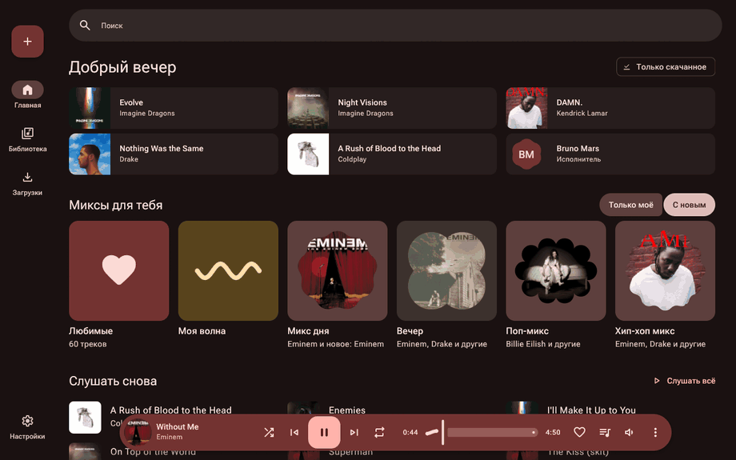
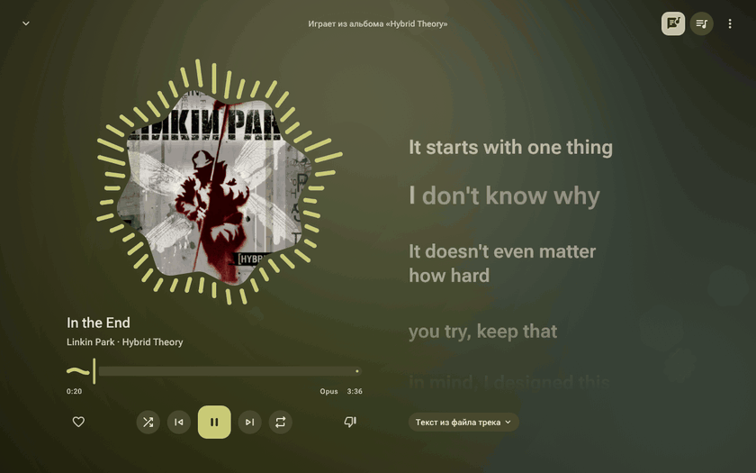
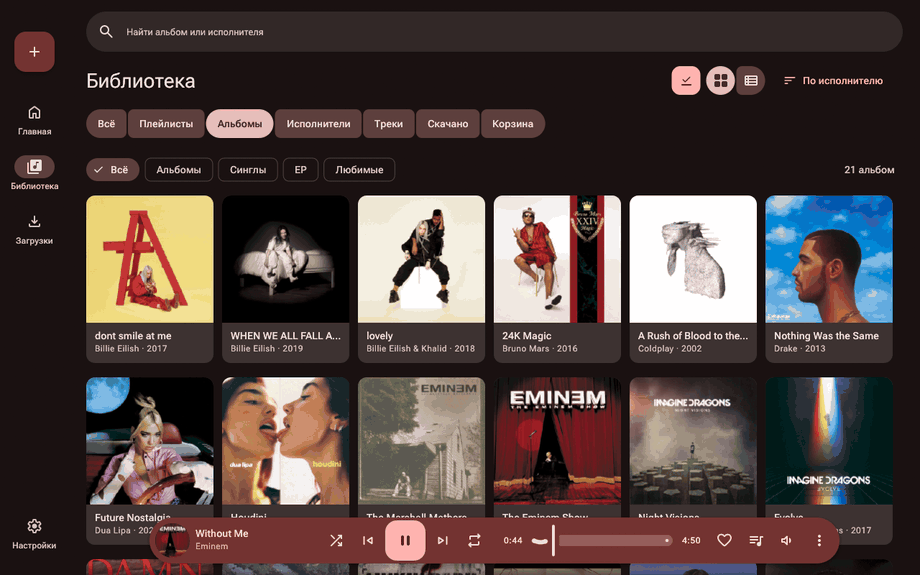
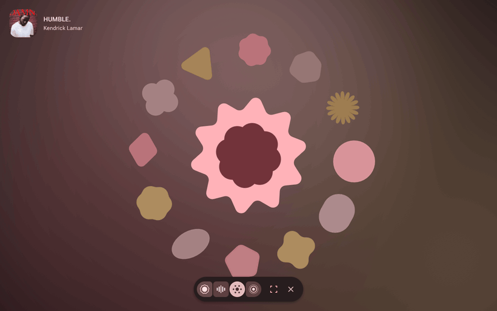
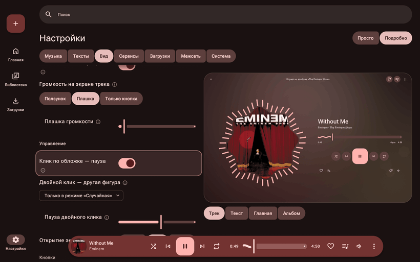
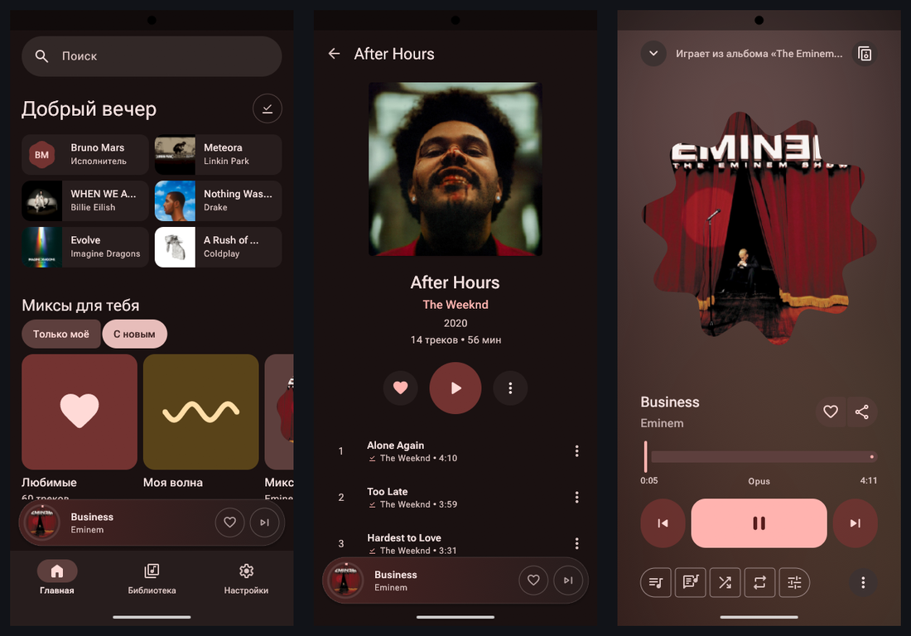

<div align="center">


# music.nikgob

**Нативный музыкальный плеер на Rust: локальная библиотека на первом месте, мост со стримингами, караоке-разметка текста по звуку, умные рекомендации и сеть своих устройств.**

Автор — **[NikGob](https://github.com/NikGob)**

[](README.md)
[](https://github.com/NikGob/music.nikgob/releases)
[](Cargo.toml)
[](LICENSE.md)

<br />



</div>

---

> [!WARNING]
> **Ранняя пре-версия (`v0.1.0`) — продукт сырой и требует обкатки**
>
> Это первый публичный пре-релиз плеера, который делался для себя. Сейчас в нём много мест, требующих тестирования и доводки:
> - **Spotify и SoundCloud** работают, но **очень мало тестировались вживую** на разных типах подписок, региональных ограничениях, лимитах запросов и переключении между устройствами.
> - **Linux-сборки** (`x86_64` под Wayland/X11, NixOS flake и консольный демон `nikgobd` под `aarch64`) собираются и запускаются, но **тестировались заметно меньше Windows** (особенно переключение устройств PipeWire/PulseAudio, окна входа на WebKitGTK и связки ключей).
> - **Мобильная версия (`crates/mobile`)** находится в **ОЧЕНЬ ранней стадии прототипа** — сейчас это портретный тач-интерфейс в десктопной обёртке (`nikgob-phone`) поверх общего рантайма, а не готовое Android-приложение.

---

## Концепция плеера

Стриминги дают музыку только в аренду (треки пропадают, алгоритмы навязывают чужое), а классические локальные плееры заставляют вручную возиться с папками, тегами и скачиванием. **`music.nikgob` объединяет владение своей коллекцией и удобство стриминга в одном нативном процессе:**

1. **Постоянный ID трека, заменяемые источники.** У каждой песни постоянный UUID (связанный с MusicBrainz / ISRC / AcoustID). Плейлисты, лайки, история и рекомендации ссылаются на ID трека, а не на путь к файлу. У трека может быть сразу несколько источников (`Hi-Res FLAC > CD FLAC > Opus > AAC/MP3 > Spotify > YouTube Music > SoundCloud`), и плеер всегда выбирает лучший доступный.
2. **Слушай сразу — сохраняй по лайку.** Общий поиск и мгновенное прослушивание работают сразу по локальной библиотеке, **Spotify**, **YouTube Music** и **SoundCloud** через единый звуковой движок (gapless, нормализация R128, 10-полосный эквалайзер, скорость/тон). Поставил **Лайк** стримовому треку — плеер сам ставит его в «Хочу скачать», ищет в подключённых источниках (торренты через Prowlarr + встроенный `librqbit`, Soulseek, Bandcamp, Internet Archive, Subsonic, khinsider), проверяет спектр на фейковый FLAC (апскейл из MP3), кодирует рабочий `.opus` (`~160 кбит/с VBR`), сохраняет побайтовый `.flac`-мастер в архив, прописывает теги с обложкой и **бесшовно подменяет стрим локальным файлом во всех плейлистах и миксах**. Lossy-файлы никогда не перекодируются повторно (`lossy -> lossy` запрещён).
3. **Нативный интерфейс без WebView.** Отрисовка напрямую через OpenGL (`egui` + `fastframe`) по гайдлайнам **Material 3 Expressive**: физические пружины, морфинг фигурных обложек (порт `androidx.graphics.shapes`), динамическая палитра от каждой обложки (`material-colors`), реакция фона на бас и 4 режима визуализатора. При закрытии окна в трей — **0 перерисовок** и выгрузка лишних текстур с видеокарты, пока музыка продолжает играть.
4. **Тексты песен и рекомендации на устройстве.** Каждый найденный текст (LRCLIB, Genius, теги) сверяется со звуком самой записи, чтобы отсеивать чужие версии и сдвиги тайминга. Локальные ONNX-модели (отделение вокала MDX-Net + выравнивание wav2vec2 / MMS на видеокарте DirectML или процессоре) строят пословную и послоговую караоке-подсветку без облаков. Рекомендации объединяют анализ звука (`bliss` + опциональный `Discogs-EffNet`), граф похожести (радио YouTube, Deezer, Last.fm, ListenBrainz) и личную историю прослушиваний («Моя волна», миксы дня и сцен, радио, автодополнение плейлистов).
5. **Межсеть (`Межсеть`), `nikgobd` и MCP.** Свои устройства (ПК, Raspberry Pi / домашний сервер с безголовым `nikgobd`) находят друг друга по mDNS и связываются напрямую через `iroh` (QUIC): синхронизация медиатеки и истории без сторонних облаков, репликация `.opus` и `.flac`-мастеров по ролям устройств, перенос звука и режим пульта в духе Spotify Connect, а также локальный REST API (`/v1`, SSE, Swagger) и встроенный **MCP-сервер** (`nikgob mcp`) для голосовых и ИИ-ассистентов.

---

## Демонстрация

### Послоговое караоке и экран воспроизведения
Плавная подсветка по слогам и словам с мягкими краями, сверка текста со звуком трека, волнистая полоса прогресса и морфинг фигур обложки.



### Библиотека, альбомы и волна перемешивания очереди
Автоматическая структура `Music/Исполнитель/Год - Альбом/`, полные и частичные альбомы, а также фирменная анимация перемешивания очереди: играющий трек остаётся на месте, а соседние строки перестраиваются волной.



### Аудиореактивный визуализатор и живая сцена настроек
<table>
<tr>
<td width="50%" valign="top">
<strong>4 концепта визуализатора (<code>F12</code>)</strong><br />
«Обложка», «Спектр», «Фигуры» и «Спокойно» — 64-полосный FFT и детектор бита в цветах текущего альбома.<br /><br />

</td>
<td width="50%" valign="top">
<strong>Живая сцена в Настройках</strong><br />
Режимы «Просто» и «Подробно», откат <code>Ctrl+Z</code> и интерактивное превью, показывающее эффект каждой настройки прямо при наведении.<br /><br />

</td>
</tr>
</table>

### Ранний прототип мобильной версии (`nikgob-phone`)
> **Важно:** мобильный интерфейс (`crates/mobile`) сейчас в **очень ранней версии**. Это портретная раскладка под палец, которая запускается на ПК в окне `nikgob-phone` поверх общего рантайма и сети устройств; сборка нативной оболочки под Android ещё впереди.

<div align="center">

</div>

---

## Установка и сборка

### Готовые сборки
Скачать актуальную пре-версию `v0.1.0` можно в разделе [**Releases**](https://github.com/NikGob/music.nikgob/releases):
- **Windows (`x86_64`)**: `music.nikgob-0.1.0.exe` — один портативный файл без установщика (статическая линковка CRT; системный WebView2 нужен только для входа в YouTube Music / SoundCloud).
- **Linux (`x86_64`)**: архив `music.nikgob-0.1.0-linux-x86_64.tar.gz` и пакет Arch `music.nikgob-0.1.0-1-x86_64.pkg.tar.zst`.
- **NixOS (`x86_64`)**: `music.nikgob-0.1.0-nixos-x86_64.tar.gz` (либо сборка напрямую из `flake.nix`).
- **Linux `aarch64` (Raspberry Pi 4/5 / сервер)**: `nikgobd-0.1.0-linux-aarch64.tar.gz` — консольный демон плеера без окна с юнитом `systemd --user`.

### Сборка из исходников

Требуется **Rust 1.98+** (edition 2024, зафиксирован в [`rust-toolchain.toml`](rust-toolchain.toml)).

```bash
# Чистая релизная сборка (без демо-каталога, скриншотера и дев-разделов)
cargo build --release -p nikgob

# Консольный демон без окна (Raspberry Pi / сервер)
cargo build --release -p nikgobd

# Ранний прототип телефонного интерфейса на ПК
cargo run --release -p nikgob-mobile --bin nikgob-phone
```

**Скрипты упаковки релизов:**
```powershell
# Чистый релизный .exe -> releases\music.nikgob-0.1.0.exe
.\scripts\release.ps1

# Сборка с дев-инструментами и демо-профилем -> releases\music.nikgob-0.1.0-dev.exe
.\scripts\release.ps1 -Dev
```
```bash
# Linux-архив + пакет Arch (+ --nixos для NixOS, --dev для дев-сборки)
./scripts/release-linux.sh

# Кросс-компиляция nikgobd под Raspberry Pi (aarch64, glibc 2.36+)
./scripts/release-linux-arm64.sh
```

### Дев-режим и демо-профиль (`--features dev`)

Весь демо-плеер, каталог тестовых релизов, фейковые сервисы и автоматизация скриншотов вынесены под Cargo-фичу `dev` и **полностью вырезаны из релизных бинарников**.

Чтобы запустить изолированный демо-профиль с 21 предзаполненным альбомом, 90 днями истории прослушиваний и обложками из Cover Art Archive в отдельной папке (`%LOCALAPPDATA%\nikgob-demo-profile`), не затрагивая основную библиотеку:

```bash
cargo run --features dev -p nikgob -- --demo-profile
```

Треки без файлов в демо-профиле проигрываются как тишина реальной длительности; клавиша **`Y`** (или *«Включить с YouTube»* в меню `⋮`) на лету подхватывает реальный аудиопоток с YouTube Music.

---

## Архитектура репозитория

Ядро (`core`, `runtime`) ничего не знает про `egui`: интерфейс общается с плеером исключительно через снимки состояния и команды `nikgob-view`.

| Слой | Крейты |
|---|---|
| **Ядро и звук** | `crates/core` (модели, настройки, трейты), `crates/audio` (декод Symphonia + `libopus` с честным gapless, R128, 10-полосный EQ, скорость/тон, FFT, вывод `cpal`), `crates/playback` (движок и захват), `crates/library` (SQLite WAL, FTS, слияние userdata) |
| **Импорт и загрузки** | `crates/import` (отпечатки AcoustID, проверка спектра на фейковый FLAC, кодирование Opus, нарезка `.cue`, атомарная раскладка, FLAC-мастера), `crates/metadata` (MusicBrainz, CAA, Deezer, LRCLIB, Genius), `crates/sources`, `crates/torrent` (`librqbit`), `crates/indexer-prowlarr`, `crates/soulseek` (`nikgob-slsk`) |
| **Стриминги** | `crates/youtube` (`rustypipe`), `crates/spotify` (Web API + `librespot`), `crates/soloist` (захват звука официального Spotify Soloist), `crates/soundcloud` (API v2 HLS), `crates/sc-widget` (захват DRM-треков), `crates/deezer` |
| **Интеллект** | `crates/recs` (векторы `bliss`, `Discogs-EffNet`, модель вкуса и скипов, граф похожести, «Моя волна» и миксы), `crates/align` (отделение вокала MDX-Net, выравнивание wav2vec2/MMS CTC, Whisper) |
| **Рантайм и сеть** | `crates/runtime` (цикл плеера, очереди, фолбэк стримов), `crates/api` (REST `/v1`, SSE, Swagger), `crates/mcp` (MCP-сервер по stdio и HTTP), `crates/mesh` (кольцо ключей Ed25519, mDNS, синхронизация и пульт через `iroh` QUIC) |
| **Интерфейсы** | `crates/view` (общая view-модель), `crates/motion` (пружины M3E), `crates/shapes` (морфинг фигур), `crates/md3e` (десктопный UI), `crates/mobile` (ранний мобильный UI и `nikgob-phone`), `crates/app` (`nikgob`), `crates/nikgobd` (консольный демон) |

---

## Что требует доработки и помощи контрибьюторов

Буду рад баг-репортам, тестам на разном железе/ОС и точечным PR по следующим задачам:

- **Обкатка Spotify и SoundCloud (`crates/spotify`, `crates/soloist`, `crates/soundcloud`, `crates/sc-widget`)**
  - Проверка крайних случаев на Free / Premium / Go+ аккаунтах, обновления токенов и пауз `Retry-After` при лимитах API.
  - Перехват потока Spotify между несколькими устройствами и перемотка вперёд в ещё не буферизованную область `librespot` без блокировки отмены чтения.
  - Окна OAuth-входа SoundCloud, восстановление долгих HLS-потоков после обрыва и аккуратный фолбэк на Linux (где нет Widevine в WebView2).
- **Тестирование и доводка под Linux и Raspberry Pi (`crates/app`, `crates/audio`, `crates/nikgobd`)**
  - Сворачивание в трей и пересоздание окна под Wayland и X11, дробное масштабирование, заголовки окон в GNOME/KDE/Hyprland/Sway и вход через WebKitGTK.
  - Выбор и горячая смена аудиоустройств в PipeWire / PulseAudio, хранение сессии Spotify в Secret Service (GNOME Keyring, KWallet, KeePassXC).
  - Живая проверка связки ПК ↔ `nikgobd` на Raspberry Pi 4/5 (`aarch64`): привязка, репликация файлов по хешу и режим удалённого вывода звука.
- **Отзывчивость интерфейса и память (`crates/runtime`, `crates/md3e`, `crates/youtube`)**
  - Вынос оставшихся синхронных операций (`LoadHome`, debounce и отмена устаревших запросов поиска на каждую букву, холодный старт `PlayRelease`) полностью из цикла рантайма.
  - Починка редких миганий вытесненных обложек `egui_glow` (`Managed texture`), когда одновременно открыто второе окно (сцена настроек, диалог текста — `crates/md3e/src/covers.rs`).
  - Ограничение размера `lyrics_cache` и отказ от лишнего клонирования буфера при записи кэша потоков YouTube (`crates/youtube/src/range.rs`).
- **Загрузки, торренты и метаданные (`crates/torrent`, `crates/soulseek`, `crates/metadata`, `crates/import`)**
  - Автоматический перезапуск сессии `librqbit` при падении диспетчера uTP (`error accepting uTP: dispatcher dead`).
  - Защита потока `youtube` (`catch_unwind`) от паник внутри `rustypipe` при полном обрыве сети.
  - Проверка границ длительности (`1..=3600` с) перед отправкой запросов в LRCLIB и сохранение пауз отказавших источников между перезапусками.
  - Полевые тесты собственного клиента `nikgob-soulseek` в живой сети Soulseek и безопасный перенос папки именованных FLAC-мастеров.
- **Рекомендации и «Моя волна» (`crates/recs`, `crates/runtime/src/recs`)**
  - Перевод ранжирования «Моей волны» с ручной формулы на обученную модель вкуса/скипов, подключение предпрослушивания превью (`want_preview`) для кандидатов открытия, сохранение памяти бандита между запусками и учёт 400 жанровых активаций `Discogs-EffNet`.
- **Мобильное приложение и локализация (`crates/mobile`, `crates/md3e`)**
  - Развитие раннего прототипа `nikgob-mobile` в полноценную Android-оболочку (Kotlin/Media3 + общее Rust-ядро), доводка жестов и вынос русских строк интерфейса в систему локализации (RU / EN).

---

## Лицензия и вклад в проект

Copyright © 2026 **[NikGob](https://github.com/NikGob)**.  
Код распространяется по лицензии [**PolyForm Strict License 1.0.0**](LICENSE.md) — бесплатно для личного, исследовательского и некоммерческого использования; коммерческое использование и распространение изменённых сборок запрещены.

**Разрешение для контрибьюторов (Pull Requests):**  
В отступление от ограничения PolyForm Strict License 1.0.0 на изменение кода, автор (**NikGob**) явно разрешает делать форк этого репозитория и вносить изменения в исходный код **исключительно для личной проверки и отправки Pull Request обратно в [`NikGob/music.nikgob`](https://github.com/NikGob/music.nikgob)**. Отправляя Pull Request, вы соглашаетесь с тем, что автор проекта вправе включать, дорабатывать и распространять ваш вклад в составе `music.nikgob` под лицензией проекта.
